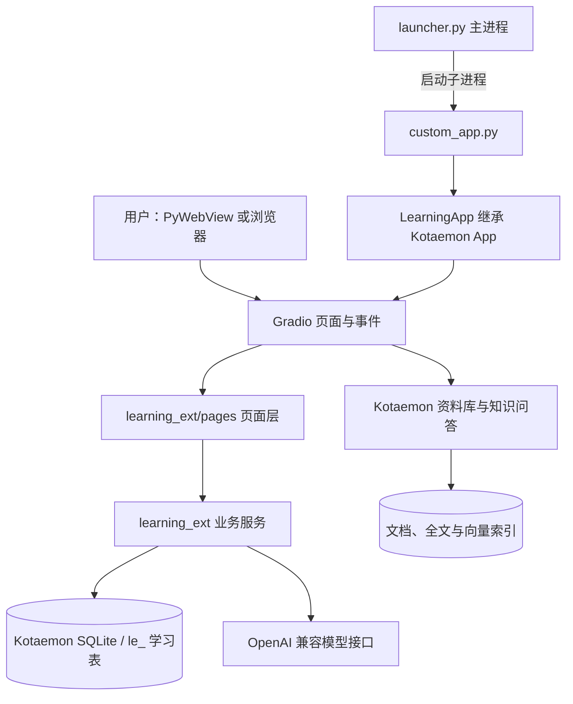
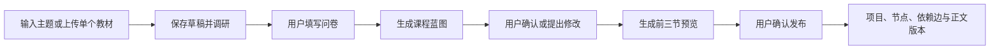

# Keep Learning 当前架构

> 代码基线：2026-09-23 工作区，应用版本 `2.0.0`。本文描述当前实现；功能运行仍取决于本地依赖、模型配置和环境。

## 1. 总体结构

Keep Learning 是 Windows 本地学习应用。PyWebView 提供桌面窗口，Gradio 提供界面和事件回调；Kotaemon 提供资料库、知识问答和数据库底座，`learning_ext/` 实现课程、学习、复习和测验。

### 启动链路

1. `launcher.py` 检查 `kotaemon/.venv`，选择本地端口，使用虚拟环境中的 Python 启动 `custom_app.py` 子进程。
2. `custom_app.py` 设置运行环境和导入路径，创建 `LearningApp`，执行 `demo.queue().launch()`。
3. 启动器等待服务端口可连接后，默认尝试打开 PyWebView；`LE_DESKTOP=0` 或 PyWebView 不可用时使用浏览器。窗口退出时清理后端进程。

Gradio 服务绑定 `127.0.0.1`，默认从端口 `7860` 开始寻找可用端口。启动器与后端是两个 Python 进程；打包的 exe 主要承载启动器，业务代码仍由随包的 Kotaemon 虚拟环境运行。`run.bat` 用于本地启动，`build_exe.bat` 与 `pack_portable.bat` 分别负责启动器打包和便携版组装。

## 2. 代码边界

| 位置 | 当前职责 |
| --- | --- |
| `launcher.py`、`custom_app.py` | 桌面窗口、后端进程和 Gradio 启动入口 |
| `learning_ext/app.py` | 继承 Kotaemon App，初始化学习模块，组装页面并注册事件 |
| `learning_ext/pages/` | 页面组件、交互状态和事件回调 |
| `learning_ext/course_creation/` | 教材解析、资料调研、问卷、蓝图、预览与发布 |
| `learning_ext/path_generator/` | 原有学习路线生成、保存及 JSON 导入导出 |
| `learning_ext/progress/`、`lesson_jobs.py` | 课节生成、节点状态、掌握度和进度；单工作线程处理课节生成任务 |
| `learning_ext/fsrs_review/`、`quiz/` | 卡片调度与复习日志；出题、批改和答题记录 |
| `learning_ext/notes/`、`practice/` | 笔记、参考资料、课节练习及辅助服务 |
| `learning_ext/llm/` | 学习业务的模型调用与结构化输出处理 |
| `learning_ext/db/models.py`、`bootstrap.py` | 学习数据模型、建表和已有 SQLite 表的增量字段处理 |
| `kotaemon/` | 资料库、知识问答及共享运行底座 |

`feynman/`、`exporter/`、`dashboard/` 等目录包含服务实现，但当前 `LearningApp.ui()` 没有把它们分别注册成可见的费曼、导出或看板页面。代码存在不等于对应端到端入口已经交付。

## 3. 页面与课程主流程

`LearningApp.ui()` 当前注册：首页、我的课程、课程管理、知识问答、间隔复习、查漏测验、资料库和模型配置。首页的 `CourseCreatorPage` 承担课程创建；`CoursePage` 承担课程目录与学习内容；`CourseManagementPage` 管理草稿和正式课程。`learning_ext/assets/` 的脚本补充目录、导航和工作台交互。

### V2 课程创建

- `CourseDraft` 保存各步状态、问卷答案、蓝图、预览和修订号；`CourseSource` 保存教材或搜索来源。上传教材支持 PDF、DOCX、TXT、Markdown；当前没有 OCR。
- 调研阶段由模型生成搜索词，通过公开 HTML 搜索获取标题、链接和摘要，再生成调研简报与问卷。搜索摘要不等于已读取网页全文，也不构成段落级引用。
- 蓝图以“课程 → 单元 → 讲次 → 课节”组织，并校验课节编号及前置课节顺序。修改蓝图会产生新修订并清除旧预览。
- 预览只生成前 `min(3, 课节数)` 节。发布时检查预览数量和蓝图修订号；重复发布同一草稿会返回已有项目。
- 发布调用 `save_roadmap()`，将课节转换为 `LearningProject`、`KnowledgeNode` 和 `KnowledgeEdge`，保存完整 `course_blueprint_json`；预览正文写入节点及 `LessonContentRevision`。其余课节按需生成。

原有的“主题 → 学习路线 → 项目”流程仍保留在 `path_generator/`，与 V2 课程创建共用正式项目和知识节点模型。正式课程页面按蓝图显示单元、讲次、课节；旧项目没有蓝图时，按节点编号回退组织目录。`KnowledgeNode.stage` 仍作为兼容字段保存，不是当前课程目录的主要分组依据。

### 学习、复习与测验

- 我的课程展示课节正文、练习、笔记、参考资料与当前课节 AI 助手，并提供节点状态操作。课节正文可重新生成和审计；后台生成任务在进程内线程池排队，任务状态也保存在内存中。
- 间隔复习以 `Card` 和 `ReviewLog` 保存 FSRS 调度状态与评分；`request_id` 为一次评分去重。查漏测验保存题目、答案、批改反馈及答题记录，也对提交使用 `request_id` 去重。
- `progress/service.py` 根据最近测验正确率、卡片稳定性和节点状态更新 `mastery`，当前权重分别为 `0.4 / 0.3 / 0.3`。这是应用中的启发式进度分数，不是经独立验证的知识掌握概率。

## 4. Kotaemon、RAG 与模型调用

`LearningApp` 继承 Kotaemon App，沿用其 Gradio 基础、`BasePage`、资料库、知识问答和 `ktem.db.engine.engine`。`LearningIndexManager` 在启动时跳过未启用的图谱索引。资料库的文件、全文索引和向量索引由 Kotaemon 管理。

学习业务的 `learning_ext.llm.chat/chat_json` **不经过** `ktem.llms.manager.llms`：它优先读取 `kotaemon/.env` 中的 OpenAI 兼容配置，再通过 OpenAI SDK 调用模型。模型配置页写入 `.env`，并尝试更新运行时配置。业务提示词位于相关模块的 `prompts.py`。

“知识问答”是 Kotaemon 的独立入口，可使用其资料库检索能力。课程内 AI 助手当前使用课节正文摘要和近期对话作为上下文，直接调用学习模块 LLM 客户端；该路径没有调用 Kotaemon 文档索引检索。课程创建时的网络搜索用于调研和蓝图生成，也不等同于知识库 RAG。

课程创建采用固定的“调研 → 问卷 → 蓝图 → 预览 → 发布”步骤，关键节点由用户确认。当前整体更准确地描述为有人参与的 LLM Workflow，而不是具备自主工具选择和动态反馈循环的通用 Agent。

## 5. 数据与持久化

`kotaemon/flowsettings.py` 将应用数据放在 `kotaemon/ktem_app_data/`：SQLite 位于 `user_data/sql.db`，上传文件、文档索引和向量索引也位于 `user_data/` 下。学习模型使用同一个 SQLModel/SQLite engine，表名统一以 `le_` 开头。

| 数据组 | 主要表 | 关系或用途 |
| --- | --- | --- |
| 课程创建 | `le_course_draft`、`le_course_source` | 草稿状态、调研来源和发布关联 |
| 正式课程 | `le_project`、`le_knode`、`le_kedge`、`le_lesson_content` | 项目、课节、前置依赖和正文版本 |
| 复习 | `le_card`、`le_reviewlog` | FSRS 卡片状态与复习历史 |
| 测验 | `le_quiz`、`le_quiz_question`、`le_quiz_attempt` | 测验、题目、答题和批改 |
| 学习记录 | `le_progress`、`le_note`、`le_resource`、`le_task`、`le_daily_report` | 进度、笔记、资料、任务及日报数据 |

核心关系是“用户标识 → 项目 → 知识节点/课节 → 卡片、测验、笔记等”。桌面流程多处仍使用本地 `default` 用户；部分新数据虽有 `owner_id`，不能据此推断已完成多用户在线隔离。启动时 `SQLModel.metadata.create_all()` 建表，`bootstrap.py` 对已有 SQLite 表补列和索引；当前没有统一的版本化迁移框架。

## 6. 当前实现边界与后续演进

- 课程调研当前以搜索摘要为主，没有对每个网页建立全文抓取和段落引用；课程创建只接收单个教材，扫描 PDF 没有 OCR。
- Gradio 页面回调直接执行对应业务流程；课节后台任务使用进程内线程池，进程重启后不会自动续跑。
- 当前桌面版没有独立 FastAPI 学习服务或 Next.js 前端。将 Kotaemon 缩为 RAG 服务、拆分独立前端仍属于后续演进。
- 本文反映代码结构，不代表重新执行了完整回归、真实模型调用或便携版启动验收。

## 7. 开发约定

- 学习特化功能放在 `learning_ext/`，避免直接修改 `kotaemon/` 底座。
- service 函数以 `session: Session` 为主要数据库依赖；页面回调负责创建会话并调用服务。
- 学习业务调用模型统一走 `learning_ext.llm.chat/chat_json`；复杂提示词放在各模块 `prompts.py`。
- 新增可见页面时，在 `learning_ext/pages/` 实现页面类，并在 `LearningApp` 中注册页面与事件。
- 修改启动器后需要重新打包 exe；修改学习业务代码后的分发包也需重新组装，才能包含最新文件。
